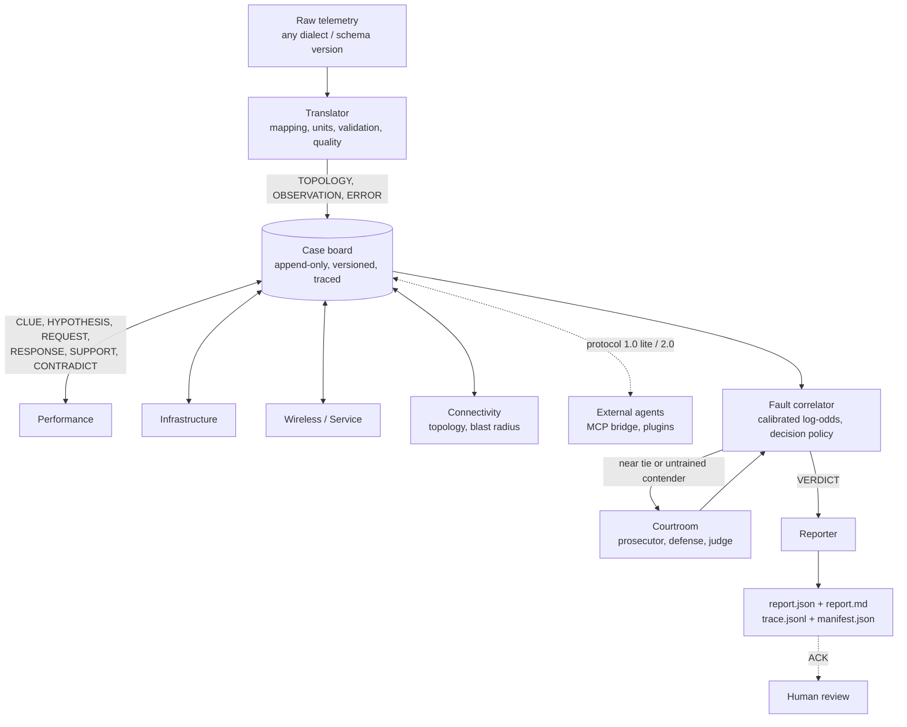

# NetCoop AI

Interoperable multi-agent network fault diagnosis (Agentic AI Hackathon, IIT Bhubaneswar).

Specialist agents examine different parts of a network's health. They exchange typed,
versioned messages on a shared case board, argue when explanations compete, and produce
**one explainable report**: a root cause with calibrated confidence, the evidence traced to
the raw telemetry, the affected devices and the recommended actions. When the evidence does
not justify a claim, the report says `insufficient_evidence` and names the data that would
settle it.

On **1,080 fresh test runs** never used for development:

| metric | value |
|---|---|
| precision of claims (diagnoses + "no fault") | **98.6%** (12 wrong of 846) |
| root-cause accuracy over all runs | 77.2% |
| honest abstentions | 21.7% |
| macro-F1 | 0.860 |
| root localisation of correct-type claims | 100% |
| wrong claims on fault types never seen in training (120 runs) | 0 |

Details, slices, ablations and robustness curves: [docs/EVALUATION.md](docs/EVALUATION.md).

## Judging criteria at a glance

| criterion (weight) | what NetCoop does | evidence to check |
|---|---|---|
| **Interoperability and protocol (30%)** | 13 typed, versioned message types with capability cards and 1.0 ↔ 2.0 adapters. A declarative Translator reads any CSV / JSON / JSONL dialect and never crashes on input. | [PROTOCOL.md](docs/PROTOCOL.md), [JSON Schemas](docs/schemas/), [TRANSLATOR.md](docs/TRANSLATOR.md), [INTEROP_RESULTS.md](docs/INTEROP_RESULTS.md) (22 mutation kinds, 0 failures, 0 crashes), demo scene 2 |
| **Diagnostic accuracy and evidence (25%)** | Calibrated detection and correlation. Every evidence item is traced to raw observations and to the config key it was judged against. | [EVALUATION.md](docs/EVALUATION.md) (98.6% precision of claims, 100% root localisation), [SCORING.md](docs/SCORING.md), [example reports](docs/examples/) |
| **Orchestration and conflict resolution (15%)** | Shared case board with capability routing, concurrent rounds with deterministic commits, failure isolation, and a courtroom tie-break that argues only from discriminating evidence. | [ORCHESTRATION.md](docs/ORCHESTRATION.md), [COURTROOM.md](docs/COURTROOM.md), [COURTROOM_RESULTS.md](docs/COURTROOM_RESULTS.md) (wrong claims 32 → 0 on ambiguous cases), demo scenes 1, 4, 5 |
| **Robustness (15%)** | Typed errors, data-quality scores, and abstention instead of guessing. A fatal input error can never yield "no fault". | Robustness tables in [EVALUATION.md](docs/EVALUATION.md) (precision ≥ 95.7% with 3 stacked interop mutations), demo scene 3 |
| **Innovation and extensibility (10%)** | Agents and faults defined as data, an MCP server and external-agent bridge, pause/resume with identical traces, and human review recorded in the trace. | [EXTENDING.md](docs/EXTENDING.md), [examples/extension/](examples/extension/) |
| **Code, docs and demo (5%)** | CI (ruff, mypy strict, schema freshness, pytest), 246 tests at 84% coverage, a self-checking demo, and a decision log. | [.github/workflows/ci.yml](.github/workflows/ci.yml), [DEMO_SCRIPT.md](docs/DEMO_SCRIPT.md), [DECISIONS.md](docs/DECISIONS.md), [RUBRIC_MAP.md](docs/RUBRIC_MAP.md) |

## Deliverables

| deliverable | where |
|---|---|
| Source code (agents, protocol, Translator, orchestrator, correlation, courtroom, reporting) | [netcoop/](netcoop/) |
| Protocol specification and schemas | [docs/PROTOCOL.md](docs/PROTOCOL.md), [docs/schemas/](docs/schemas/) |
| Unified diagnostic reports (JSON and Markdown) | [docs/examples/](docs/examples/); every run writes `runs/<incident>/report.json` and `report.md` |
| Message traces | `runs/<incident>/trace.jsonl`, replayable with `netcoop replay` |
| Evaluation results | [docs/EVALUATION.md](docs/EVALUATION.md), [docs/CALIBRATION.md](docs/CALIBRATION.md) |
| Labelled sample data | [data/samples/](data/samples/README.md) |
| Local dashboard | `netcoop serve`, [docs/WEB.md](docs/WEB.md) |
| Demo and video script | `netcoop demo`, [docs/DEMO_SCRIPT.md](docs/DEMO_SCRIPT.md) |
| Design decisions | [docs/DECISIONS.md](docs/DECISIONS.md) |

## Quick start

Requires Python 3.11+. Nine labelled sample runs are committed in
[data/samples/](data/samples/README.md), and the fitted model and baselines are in `config/`,
so nothing needs to be generated or trained first.

```bash
python -m venv .venv
```

Activate the venv (`source .venv/bin/activate`, or `.venv\Scripts\activate` on Windows), then:

```bash
pip install -e ".[dev]"
```

```bash
netcoop serve
```

`netcoop serve` opens the **local dashboard** at http://127.0.0.1:8765/ ([docs/WEB.md](docs/WEB.md)):
pick a sample, press Diagnose, and watch Fig. 1 fill in as the agents post messages. The
report reads like a research paper: every red citation number links a claim to the board
message that proves it. It needs no extra installs and only listens on your own machine.

```bash
netcoop demo
```

`netcoop demo` plays the six-scene walkthrough used in the video
([docs/DEMO_SCRIPT.md](docs/DEMO_SCRIPT.md)); add `--step` to pause between scenes or
`--scene N` to play one. To diagnose one run and watch every message:

```bash
netcoop run data/samples/link_congestion__s500__i1.0__n0.0__m0.0 -v
```

This writes `runs/<incident>/` with `report.json`, `report.md`, `trace.jsonl` and
`manifest.json`. `netcoop replay runs/<incident>` rebuilds the board from the trace and
verifies it. With `make`, `make setup` creates the venv and `make demo` plays the demo.

Dependencies are declared in [pyproject.toml](pyproject.toml). The core needs pydantic,
PyYAML, networkx, NumPy, pandas and Pint. The `dev` extra adds the MCP SDK and the
test and lint tools.

## Architecture



### Overall workflow: telemetry → agents → diagnosis → report

The numbers below come from the link-congestion sample
(`data/samples/link_congestion__s500__i1.0__n0.0__m0.0`).

1. **Ingest.** The Translator reads the raw files, whatever their format, field names or
   units. It maps them to canonical metrics, scores data quality and posts
   - a TOPOLOGY message (25 devices and services, 24 links)
   - 406 OBSERVATIONs
   - typed ERRORs for anything it could not read
2. **Analyse (round 1).**
   - Each specialist compares its metrics with calibrated baselines and posts CLUEs,
     including the "checked, normal" ones: 457 here.
   - A specialist whose evidence fits a fault in the catalogue posts a HYPOTHESIS. Here,
     performance proposes link congestion on one link.
3. **Collaborate (rounds 2+).**
   - The proposer REQUESTs the evidence it cannot observe itself, and the agent that can
     observe it RESPONDs.
   - The other agents post SUPPORT or CONTRADICT stances. Connectivity checks whether the
     symptoms sit inside the link's blast radius.
   - The run ends when a round produces nothing new, or at the round limit.
4. **Correlate.** The correlator scores every candidate from all the evidence on the board.
   - It produces calibrated log-odds, merging symptoms into their cause.
   - It claims a cause only above the calibrated operating point, and abstains otherwise.
   - A near tie between two explanations goes to the courtroom.
5. **Report.** The reporter publishes one report: `report.json` (schema-valid) and
   `report.md`. It holds
   - the root cause and the affected devices
   - the evidence, each item traced to the observations it came from
   - recommended actions and alternatives
   - limitations
6. **Trace.** Every message is in `trace.jsonl`, and `netcoop replay` verifies it. The same
   input and config always give a byte-identical trace.

### Orchestration

The orchestrator never names an agent. Agents are plugins with capability cards. The
orchestrator:

- negotiates protocol versions
- activates agents whose metrics exist in the data
- delivers each agent the messages its card asks for
- routes REQUESTs by capability
- runs agents concurrently but commits their posts in a fixed order
- isolates failures and timeouts
- stops on convergence or at the round limit

See [ORCHESTRATION.md](docs/ORCHESTRATION.md).

### Agent responsibilities

| agent | looks at | proposes |
|---|---|---|
| Translator | any CSV / JSON / JSONL export | canonical observations, topology, typed errors, data quality |
| performance | latency, jitter, loss, throughput, utilisation | link_congestion |
| infrastructure | device status, CPU, memory, queue drops, interface errors and trends | interface_fault, hardware_failure, device_overload |
| wireless_service | RSSI, SNR, retransmissions, clients, DNS / DHCP probes | weak_wifi_signal, dns_service_failure, dhcp_service_failure |
| connectivity | topology | supports or contradicts each hypothesis's localisation |
| correlator | the whole board | ranked, calibrated candidates and the VERDICT |
| prosecutor / defense / judge | discriminating evidence for two contenders | courtroom ruling |
| reporter | VERDICT and its evidence | the A7 report with traced evidence and actions |

The three metric specialists and all seven faults are **data**
([config/catalogue/](config/catalogue/), [AGENTS.md](docs/AGENTS.md)). The faults an agent
may propose are derived from what it can observe, never listed by hand.

### Communication and interfaces

Agents never call each other. They communicate only through typed messages on the shared case
board. The message protocol is in [PROTOCOL.md](docs/PROTOCOL.md), with the generated field
reference in [PROTOCOL_REFERENCE.md](docs/PROTOCOL_REFERENCE.md) and JSON Schemas in
[docs/schemas/](docs/schemas/).

- **Messages:** 13 typed message types in a versioned envelope:
  - CAPABILITY, TOPOLOGY, OBSERVATION, CLUE
  - HYPOTHESIS, REQUEST, RESPONSE, SUPPORT, CONTRADICT
  - VERDICT, REPORT, ERROR, ACK
- **Ids:** content-hash ids make re-posting idempotent.
- **Causation:** every message carries a causation chain, which allows loop control.
- **Vocabulary:** metrics, units, entity types and hypotheses come from a controlled
  vocabulary.
- **Versions:** a protocol 1.0 "lite" profile has adapters to and from 2.0.

External interfaces:

| interface | entry point |
|---|---|
| command line | `netcoop` (`run`, `demo`, `serve`, `replay`, `translate`, `eval`, …) |
| Python API | `netcoop.api.diagnose(path)` returns the report; `run_diagnosis(...)` also returns the board and trace |
| local dashboard and HTTP API | `netcoop serve` ([WEB.md](docs/WEB.md)) |
| MCP server for other AI agents | `netcoop mcp` ([EXTENDING.md](docs/EXTENDING.md)) |

### Interoperability

The Translator is driven by a declarative mapping ([data/mappings/canonical.yaml](data/mappings/canonical.yaml)).
It sniffs formats and resolves field aliases. Units are taken from declarations, inferred
from suffixes, or inferred from plausible value ranges. Each sample gets five validation
layers and provenance. The Translator never raises on input.

A 22-kind mutation corpus checks every case for exact recovery, a flagged ambiguity or the
expected typed error ([TRANSLATOR.md](docs/TRANSLATOR.md), [INTEROP_RESULTS.md](docs/INTEROP_RESULTS.md)).

### Evidence correlation and decisions

Every formula is in [SCORING.md](docs/SCORING.md).

1. **Detection:** calibrated percentile baselines, cited thresholds with a standard-error
   gate, an in-window median-shift test, and a Mann-Kendall trend on the recent window.
2. **Correlation:** naive-Bayes log-likelihood ratios with shrinkage over signature
   elements, observation-level independence, analytic stances and evidence quality. These are
   Platt-calibrated on held-out seeds, and causal merging folds symptoms into their cause.
3. **Decision policy:** NetCoop claims a cause only above an operating point fitted for
   target precision. It says "no fault" only when the fault types were actually assessable
   and no fatal input or agent error occurred. Otherwise it abstains
   ([CALIBRATION.md](docs/CALIBRATION.md)).
4. **Courtroom:** opens on a near tie or an under-trained overlapping contender. The rubric
   scores only discriminating evidence, weighted by quality, and the judge may confirm,
   accept or defer ([COURTROOM.md](docs/COURTROOM.md), [COURTROOM_RESULTS.md](docs/COURTROOM_RESULTS.md)).

### Error handling

| problem | what NetCoop does |
|---|---|
| bad, missing or ambiguous input | typed `ERROR` messages and lower data-quality scores |
| failing or timed-out agents | disabled for the rest of the run; their missing evidence is listed in the report |
| floods and loops | stopped by board budgets and causation depth |

A fatal problem never produces a false "no fault".

## Sample data and test cases

**Sample inputs.** Nine labelled runs ship in [data/samples/](data/samples/README.md). They
come from fresh seeds never used for training.

| input | ground truth | NetCoop outcome |
|---|---|---|
| normal network operation | normal | no fault detected |
| link congestion (strong, then faint) | link_congestion | diagnosed; the faint one abstains |
| interface fault | interface_fault | diagnosed after a courtroom tie-break |
| DNS / DHCP failure | dns_dhcp_failure | diagnosed |
| weak Wi-Fi | weak_wifi | diagnosed |
| legacy CSV export | dns_dhcp_failure | diagnosed through the legacy dialect |
| device overload | device_overload | diagnosed |
| hardware failure (never seen in training) | hardware_failure | abstains; the courtroom defers |

Each folder holds the raw telemetry and the topology, and `meta.json` holds the ground truth.
`make generate` builds the full 1,080-run labelled dataset.

**Test cases.** Run the tests with:

```bash
pytest
```

`make test` runs the same tests with coverage. The tests in [tests/](tests/) cover:

- the protocol, the Translator (including property-based tests), the board and orchestrator,
  the agents, correlation, the courtroom and reporting
- an acceptance gate for every hackathon requirement
- the committed samples: each must regenerate byte for byte, and each demo scene must give its
  expected outcome
- the dashboard server, including its file-access limits

CI runs lint, strict type checks, a schema freshness check and the tests on every push
([.github/workflows/ci.yml](.github/workflows/ci.yml)).

## Configuration and calibration

Every tunable value lives in `config/*.yaml` as `{value, unit, rationale, source}`. The
loader rejects bare values, so no unexplained constant enters the system. The derived files
are produced by commands from training seeds only:

- `config/baselines.yaml` comes from `netcoop calibrate`
- `config/correlation.yaml` comes from `netcoop fit`

| seeds | use |
|---|---|
| 0-2 | training |
| 3-4 | development hold-out |
| 500-504 | fresh test suite |
| 100-109 | ambiguity suite |

Every run's manifest records the input, config and code hashes. The same input and config
give a **byte-identical trace**.

## Extending

New faults, metrics and agents are YAML drop-ins; Python plugins are also supported. External
agents can join over MCP. See [EXTENDING.md](docs/EXTENDING.md), which includes the worked
example in [examples/extension/](examples/extension/).

| command | what it does |
|---|---|
| `netcoop mcp` | serves NetCoop as an MCP server (tools to diagnose, translate, read reports, traces and topology, and review actions) |
| `netcoop run --pause-after N` / `netcoop resume` | checkpoint and continue a run; the resumed trace is identical |
| `netcoop review` | records a human's approve or reject decisions on actions as ACKs in the verified trace |

Remediation is only ever simulated.

## Full pipeline

| command | what it does |
|---|---|
| `make generate` | 1,080 labelled runs (6 families × 5 seeds × 4 intensities × 3 noise × 3 missing rates), about 610 MB |
| `make calibrate` | derive the normal-operation baselines |
| `make fit` | fit and calibrate the correlation model; writes CALIBRATION.md |
| `netcoop courtroom-eval` | courtroom ablation on the ambiguity suite |
| `make eval` | full evaluation on the fresh test suite; writes EVALUATION.md (about 7 minutes; `make quick-eval` is a smoke test) |
| `netcoop interop-eval` | mutated-corpus check of the Translator |
| `make lint typecheck test` | ruff, mypy strict, pytest with coverage (also run in CI) |

The data comes from a **stand-in generator** (`generator/synth.py`, D-004), because the
organiser's generator was not available. It emits a native JSONL dialect and a legacy CSV
dialect. To use another generator, reimplement `generate(...)` in `generator/adapter.py`;
nothing else changes.

## Limitations

- **Synthetic data.** Results come from our own stand-in generator. Real exports will need
  more mapping aliases, and the model should be refitted on them.
- **Faint and noisy faults abstain often.**
  - At intensity 0.25, 44% of runs abstain.
  - weak_wifi recall is 53.5%.
  - This is the price of a 98.6% precision of claims.
  - The courtroom trades some accuracy (75.0% vs 80.1% without it on the ablation sample)
    for zero wrong claims on ambiguous cases.
- **Untrained fault types are never claimed.** hardware_failure has no training data, so the
  courtroom defers on it every time. It is honest, but it is not a diagnosis.
- **Affected-set precision is 49%.** The root is always located correctly, but the blast
  radius includes downstream devices that the ground truth does not list.
- **Staleness is relative** to the newest data in the input. A timed-out Python thread cannot
  be killed: its output is discarded, but its thread keeps running.
- The dashboard is **local and single-user**: no accounts, loopback only, and it can diagnose only run folders under `data/`.

## Future work

- Refit on the organiser's or real NMS data.
- Add active probing agents that answer REQUESTs with new measurements.
- Have the system propose mapping aliases for unrecognised dialects, gated by the validator.
- Let the dashboard upload an export instead of reading run folders from `data/`.
- Execute approved remediations behind the existing human-review ACKs.

## Repository layout

| path | contents |
|---|---|
| `netcoop/protocol` | envelope, payloads, vocabulary, version adapters, schema export |
| `netcoop/translator` | readers, mapping, units, validation, data quality |
| `netcoop/board`, `netcoop/orchestrator` | case board, rounds, routing, tracing, replay, pause/resume |
| `netcoop/agents` | plugin interface, registry, specialist engine, connectivity, external bridge |
| `netcoop/correlation`, `netcoop/courtroom` | scoring, calibration, decision policy, tie-break |
| `netcoop/reporting` | report.json / report.md |
| `netcoop/evaluation`, `netcoop/mutation.py` | evaluation harness, interop mutator |
| `netcoop/web` | local dashboard: stdlib server and one static page |
| `netcoop/demo.py`, `netcoop/mcp_server.py`, `netcoop/cli` | demo, MCP server, `netcoop` command |
| `config/` | justified parameters, catalogue, fitted model |
| `data/` | vocabulary, mappings, samples (generated data is git-ignored) |
| `docs/` | design docs, results, [DECISIONS.md](docs/DECISIONS.md) (50 decisions), [RUBRIC_MAP.md](docs/RUBRIC_MAP.md) |
