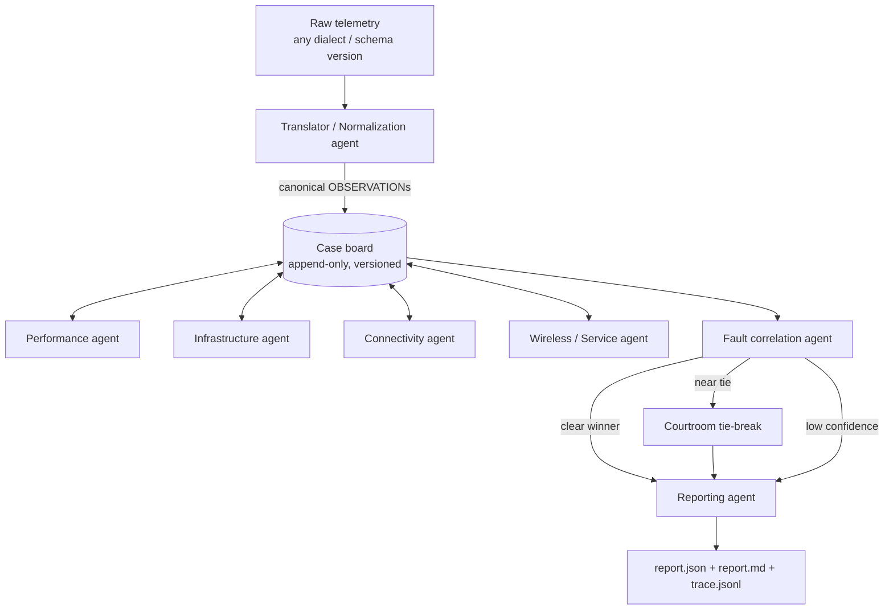

# NetCoop AI

Interoperable multi-agent network fault diagnosis (Agentic AI Hackathon, IIT Bhubaneswar).

Specialised agents analyse different aspects of network health, exchange structured
messages on a shared case board, reconcile their findings and produce one explainable
diagnostic report, including an honest `insufficient_evidence` outcome.

> **Status:** Phase 0 (foundation). Architecture docs, protocol and agents land in later phases.

## Architecture (planned)



## Quick start

Requires Python 3.11+.

```bash
make setup        # create .venv and install netcoop with dev tools
make generate     # build the labelled dataset (needs the organiser generator, see below)
make profile      # write docs/DATA_PROFILE.md from the generated data
make test
```

Without `make` (e.g. on Windows): `python -m venv .venv`, activate it, then
`pip install -e ".[dev]"` and use the `netcoop` command directly.

## Organiser generator

Put the organiser's Colab telemetry generator under `generator/` and add
`generator/adapter.py` exposing `generate(scenario, seed, intensity, noise, missing_rate, out_dir)`.
The interface is documented in `netcoop/generation.py`.

## Configuration rule

Every tunable value lives in `config/*.yaml` as `{value, unit, rationale, source}`.
The loader rejects bare values, so no unexplained constant can enter the system.

## Repository layout

| Path | Contents |
|---|---|
| `netcoop/protocol` | message envelope, payload models, vocabulary, version adapters |
| `netcoop/translator` | ingestion, field mapping, unit normalisation, validation, data quality |
| `netcoop/board` | shared append-only case board |
| `netcoop/agents` | specialist agents (plugins with capability cards) |
| `netcoop/correlation` | evidence scoring, calibration, decision policy |
| `netcoop/courtroom` | tie-break debate |
| `netcoop/reporting` | report.json / report.md |
| `netcoop/orchestrator` | dispatch, rounds, timeouts, tracing |
| `netcoop/cli` | `netcoop` command |
| `config/` | justified parameters and catalogues |
| `data/` | `raw/`, `generated/`, `mappings/` |
| `docs/` | protocol, scoring, evaluation, decisions |
