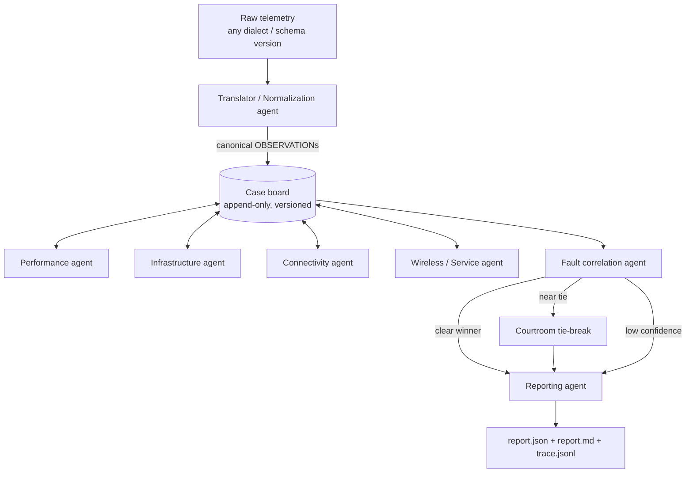

# NetCoop AI

Interoperable multi-agent network fault diagnosis (Agentic AI Hackathon, IIT Bhubaneswar).

Specialised agents analyse different aspects of network health, exchange structured
messages on a shared case board, reconcile their findings and produce one explainable
diagnostic report, including an honest `insufficient_evidence` outcome.

> **Status:** Phases 0–3 done (data, protocol, Translator, board + orchestrator). Specialist agents and correlation land next.

## Architecture (planned)



## Quick start

Requires Python 3.11+.

```bash
make setup        # create .venv and install netcoop with dev tools
make generate     # build the labelled dataset (needs the organiser generator, see below)
make profile      # write docs/DATA_PROFILE.md from the generated data
make test
netcoop run data/generated/link_congestion/<run> -v      # full pipeline, live message trace
netcoop replay runs/<incident_id>                         # rebuild + verify the board from the trace
netcoop translate data/generated/interop_failure/<run>   # canonicalise one run, list typed errors
netcoop interop-eval                                     # mutated-corpus check -> docs/INTEROP_RESULTS.md
netcoop schemas                                          # re-export JSON Schemas + protocol reference
```

Docs: [PROTOCOL.md](docs/PROTOCOL.md) (message protocol), [TRANSLATOR.md](docs/TRANSLATOR.md)
(ingestion and validation), [SCORING.md](docs/SCORING.md) (every formula),
[ORCHESTRATION.md](docs/ORCHESTRATION.md) (board, rounds, trace, replay), [DECISIONS.md](docs/DECISIONS.md) (decision log).

Without `make` (e.g. on Windows): `python -m venv .venv`, activate it, then
`pip install -e ".[dev]"` and use the `netcoop` command directly.

## Synthetic data

`make generate` builds 1080 labelled runs (6 scenario families × 5 seeds × 4 intensities ×
3 noise × 3 missing-data levels, ~610 MB, under a minute) in `data/generated/`. Each run has
`meta.json` with ground truth (root cause, target entity, affected entities, dialect).

The data currently comes from a **provisional stand-in generator** (`generator/synth.py`,
see `docs/DECISIONS.md` D-004), because the organiser's Colab generator is not available.
It emits two dialects, a native JSONL one and a legacy CSV one used by `interop_failure`.
To switch to the organiser's generator, reimplement `generate(...)` in `generator/adapter.py`;
nothing else changes. Field inventory: `docs/DATA_PROFILE.md`.

## Configuration rule

Every tunable value lives in `config/*.yaml` as `{value, unit, rationale, source}`.
The loader rejects bare values, so no unexplained constant can enter the system.

## Repository layout

| Path | Contents |
|---|---|
| `netcoop/protocol` | message envelope, payload models, vocabulary, version adapters |
| `netcoop/translator` | ingestion, field mapping, unit normalisation, validation, data quality |
| `netcoop/board` | shared append-only case board |
| `netcoop/agents` | specialist agents (plugins with capability cards) |
| `netcoop/correlation` | evidence scoring, calibration, decision policy |
| `netcoop/courtroom` | tie-break debate |
| `netcoop/reporting` | report.json / report.md |
| `netcoop/orchestrator` | dispatch, rounds, timeouts, tracing |
| `netcoop/cli` | `netcoop` command |
| `config/` | justified parameters and catalogues |
| `data/` | `raw/`, `generated/`, `mappings/` |
| `docs/` | protocol, scoring, evaluation, decisions |
