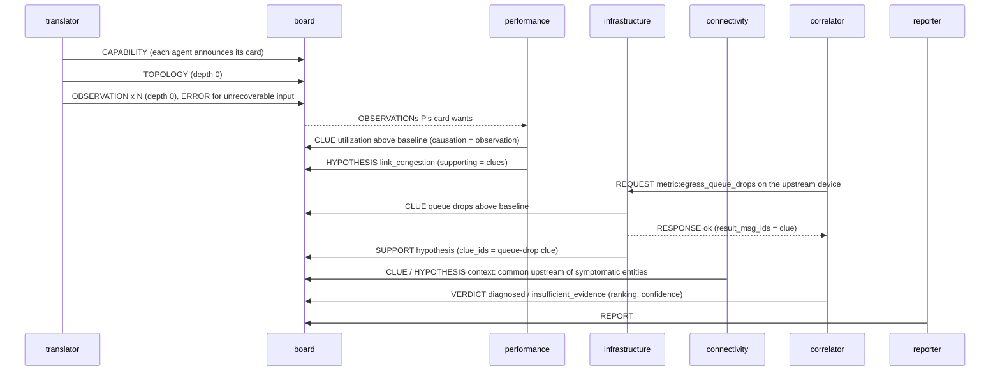

# The netcoop protocol (v2.0)

NetCoop agents talk only through typed, versioned JSON messages. This document defines the
rules and meaning of those messages. Two generated artefacts complete it:

- [`PROTOCOL_REFERENCE.md`](PROTOCOL_REFERENCE.md) lists **every field** with its type,
  whether it is required, its unit, allowed values and meaning, plus the controlled vocabulary.
  It is generated from the code by `netcoop schemas`, and a test fails if it goes stale.
- [`schemas/`](schemas/) holds JSON Schema (2020-12) for the message union (`message.json`),
  each message type (`messages/*.json`), the capability card and the report.

The examples in this file are checked by the test suite, so every example here is a valid message.

## 1. Design principles

1. **One canonical language.** Payloads use only terms from the controlled vocabulary
   (`data/vocabulary/*.yaml`): canonical metric names, canonical units, entity types and
   hypothesis types. Dialect differences (field names, units, schema versions) are resolved
   once, at the boundary, by the Translator. Specialist agents never see raw field names.
2. **Strict, typed, self-describing.** Every message is validated on parse. Unknown fields,
   unknown terms, non-canonical units, physically impossible values and a payload that does
   not match the declared `type` are all rejected. Within one version nothing is silently ignored.
3. **Traceable.** Every message names its incident (`correlation_id`) and parent
   (`causation_id`). Evidence names the observations it was computed from, and observations
   name their source file and line. Any statement in a report can be followed back to raw input.
4. **Deterministic.** `msg_id` is a hash of the message content, so the same input produces
   the same ids, and a duplicate post is detectable by its id alone.
5. **Honest about loss.** Version conversions record what they changed or could not carry in
   `adaptations`. Assumed values are flagged, e.g. `quality_unknown_v1`.

## 2. Transport

The protocol does not depend on a particular transport. Inside a run, messages are posted to
the **case board**, an append-only shared log (Phase 3). They are persisted one per line in
`runs/<incident_id>/trace.jsonl`, and the same JSON can be carried over REST, MCP or a queue.
Encoding is UTF-8 JSON. Timestamps are ISO-8601 with a timezone; producers emit UTC (`Z`).

## 3. Envelope

Every message has the same envelope (full table in the reference):

| field | rule |
|---|---|
| `protocol` / `protocol_version` | Always `"netcoop"` / `"2.0"` in this version. Older versions are converted on receipt (§6). |
| `schema_version` | Version of the controlled vocabulary the payload's terms come from. It must match the receiver's vocabulary. |
| `msg_id` | `<type>-<hash>`: the first `msg_id_hash_hex_chars` hex digits (config/protocol.yaml) of SHA-256 over `[type, sender, correlation_id, causation_id, payload]`. Timestamp and recipient are excluded, so re-posting the same content gives the same id. |
| `correlation_id` | The incident id. All messages of one diagnosis share it. |
| `causation_id`, `depth` | Parent message and causation depth (root = 0, child = parent + 1). The board limits depth to prevent loops (Phase 3, configured). |
| `sender`, `recipient` | `agent_id`s from capability cards. `recipient = "board"` is a shared post; any other value is a directed message (REQUEST/RESPONSE/ACK). |
| `timestamp` | When the message was created. It is informational only and never used for ordering or ids. |
| `adaptations` | Version conversions and lossy or assumed fields, e.g. `["1.0->2.0", "assumed:quality"]`. |

## 4. Message types

| type | sent by | meaning |
|---|---|---|
| `CAPABILITY` | every agent, at start | Announces the agent's capability card (§5). |
| `TOPOLOGY` | Translator | The network graph as given in the input: nodes, edges, optional direction and root. |
| `OBSERVATION` | Translator | One canonical time series: one metric on one entity, with per-sample provenance and a data-quality assessment. |
| `CLUE` | specialists | One piece of evidence: a summary statistic of a metric over a window, compared with a cited threshold or baseline, giving a direction and a normalised deviation. `significant=false` is explicit **negative** evidence ("this was checked and is normal"). |
| `HYPOTHESIS` | specialists | A suspect: hypothesis type, entities with roles (`root`, `symptom`, `context`), local confidence with a named method, and supporting/contradicting clue ids. |
| `SUPPORT` / `CONTRADICT` | any agent | A stance on another agent's CLUE or HYPOTHESIS, justified by the sender's own clues. This is how agents interpret and challenge each other's findings. |
| `REQUEST` / `RESPONSE` | any agent / the agent that serves it | Directed query for targeted evidence. Routed by capability (`metric:<name>`, `analysis:<name>`), never by a hard-coded agent name. The response points to the clues posted in answer. |
| `ERROR` | anyone | Typed error (`ErrorCode`) with severity `fatal` / `recoverable` / `warning` and the source location. Every error ends up in the report's `limitations`. |
| `ACK` | board / recipient | `accepted`, `duplicate` (same `msg_id` already posted) or `rejected` (with a reason). |
| `VERDICT` | correlator / courtroom judge | Decision (`diagnosed`, `insufficient_evidence`, `no_fault_detected`), the full ranking, calibrated confidence and category, and the missing evidence that would resolve an abstention. |
| `REPORT` | reporter | The final unified report (A7 keys plus the namespaced `x_netcoop` block). |

### 4.1 Evidence (CLUE) semantics

- `value` is a summary of the window given by `statistic`. Its unit depends on the statistic:
  the metric's canonical unit for levels (`mean`, `median`, `max`, `min`, `last`), `<unit>/interval`
  for `slope`, and `ratio` for `fraction`. The validator enforces this.
- `comparison` says what `value` was compared with. `basis = threshold` means a cited fixed
  threshold; `basis = baseline` means a statistical baseline (`reference_value` = centre, `spread` =
  scale). `config_key` names the exact config or calibration entry, so the threshold behind every
  claim can be looked up.
- `deviation` is a non-negative normalised magnitude in `deviation_unit` (e.g. `robust_z` =
  |value - median| / (1.4826 · MAD)). `direction` gives the sign. Scoring is documented in SCORING.md.
- `persistence` is the share of samples in the window that deviate. It separates sustained
  faults from single spikes. `null` means unknown (e.g. an upgraded 1.0 clue).
- `source_observation_ids` are required and non-empty. The correlator uses them to avoid
  **double counting**: two clues that share a source observation are not independent corroboration.
- `data_quality` is carried over from the observations. It feeds the confidence calculation.

### 4.2 Hypothesis semantics

- `hypothesis_type` must be a `fault` type or `normal`. `insufficient_evidence` is a verdict
  outcome only and cannot be proposed.
- `entities[].role` separates where the cause is (`root`) from where it shows (`symptom`).
  Causal merging in the correlator depends on this.
- `local_confidence` is the proposer's own view. The correlator recomputes the final confidence
  from the evidence and does not simply average local confidences (SCORING.md).

## 5. Capability cards and routing

Each agent publishes a card (`CapabilityCard`) with:

- the message types it consumes and produces
- the canonical metrics it analyses
- the hypothesis types it may propose
- the REQUEST capabilities it serves
- the protocol versions it speaks
- whether it is `optional`, and the `activation_metrics` it needs in order to run

The orchestrator:

- delivers a message to every agent whose card `wants(type, metric)` it
- routes a REQUEST to the agents whose card `can_serve(capability)`
- skips an agent whose activation metrics are absent from the data. An optional agent's
  absence does not lower confidence; a required agent's absence does.

A new agent therefore joins by shipping a card. Nothing in the engine changes.

**Version negotiation:** the protocol version for an exchange is the highest version both
cards list (`negotiate`). If there is none, the result is `INCOMPATIBLE_VERSION`. The board
itself stores 2.0. Messages from 1.0 agents are upgraded on receipt, and messages to them are
downgraded when the type exists in 1.0. Otherwise the receiver gets an `UNSUPPORTED_MESSAGE_TYPE` error.

## 6. Versioning

- `protocol_version` uses `MAJOR.MINOR`. Within a major version, a minor version may only add
  **optional** fields or new message types. Removing or renaming fields, changing units or
  changing meaning requires a new major version and an adapter.
- The vocabulary has its own version (`schema_version`). Adding terms is a minor bump; changing
  units or meaning is a major bump.
- Adapters are registered per version pair (`netcoop/protocol/versioning.py`). `convert`
  chains them along the shortest path, and failures become typed errors
  (`INCOMPATIBLE_VERSION`, `UNSUPPORTED_MESSAGE_TYPE`, `MALFORMED_INPUT`).

### 6.1 Protocol 1.0 "lite"

1.0 is a minimal profile for simple or external agents such as probes or scripts. It has a
flat envelope: `protocol`, `version`, `id`, `incident`, `from`, `to` (optional), `time`,
`type`, `payload`, plus optional `adaptations`. It supports five types:

| type | payload fields | conversion to 2.0 |
|---|---|---|
| OBSERVATION | `entity{id,type}`, `metric`, `unit`, `samples[[t, v], ...]` | `points`. No provenance. Quality is set to `v1_upgrade.assumed_data_quality` and flagged `quality_unknown_v1`. |
| CLUE | `entity`, `metric`, `unit`, `value`, `threshold`, `direction`, `deviation`, `significant`, `window[start,end]`, `observations[]` | `statistic=unspecified`, `basis=threshold`, `config_key=external:v1.0`, `persistence=null`, assumed quality. |
| HYPOTHESIS | `hypothesis`, `entities[{id,type}]`, `confidence_pct` (0-100), `supporting[]`, `contradicting[]` | Confidence ÷ 100; every entity gets the role `root` (flagged). |
| ERROR | `code`, `message`, `fatal` | `fatal → severity fatal`, otherwise `recoverable`. |
| ACK | `ack`, `status` | renamed fields. |

1.0 uses the same vocabulary terms and canonical units as 2.0. Downgrading 2.0 to 1.0 drops
causation, depth, provenance, quality and roles, and lists each dropped field in `adaptations`
as `lossy:...`.

## 7. Annotated message sequence



**A CLUE** (derived from an observation, so `depth = 1`). It cites its baseline by config key
and names the observation it came from:

<!-- example:v2 -->
```json
{
  "protocol": "netcoop",
  "protocol_version": "2.0",
  "schema_version": "1.0",
  "msg_id": "clue-bfada2abf7ab98ae",
  "correlation_id": "inc-test",
  "causation_id": "observation-1d09049525ca51a2",
  "depth": 1,
  "sender": "agent-x",
  "recipient": "board",
  "timestamp": "2026-01-01T00:00:00Z",
  "adaptations": [],
  "type": "CLUE",
  "payload": {
    "entity": {"entity_id": "sw-a--sw-b", "entity_type": "link"},
    "metric": "utilization",
    "statistic": "median",
    "value": 11.0,
    "unit": "percent",
    "comparison": {
      "basis": "baseline",
      "reference_value": 5.0,
      "spread": 1.0,
      "config_key": "baselines.utilization.link",
      "method": "robust_z"
    },
    "direction": "above",
    "deviation": 6.0,
    "deviation_unit": "robust_z",
    "significant": true,
    "persistence": 0.5,
    "window": {"start": "2026-01-01T00:00:00Z", "end": "2026-01-01T00:02:00Z"},
    "observed_from": null,
    "source_observation_ids": ["observation-0"],
    "data_quality": 0.9
  }
}
```

**The same kind of statement from a 1.0 agent.** It is upgraded on receipt: confidence becomes
0.6, roles are assumed `root`, and both conversions are recorded:

<!-- example:v1 -->
```json
{
  "protocol": "netcoop",
  "version": "1.0",
  "id": "hypothesis-2ca5d0293bf45006",
  "incident": "inc-test",
  "from": "agent-x",
  "to": "board",
  "time": "2026-01-01T00:00:00Z",
  "type": "HYPOTHESIS",
  "payload": {
    "hypothesis": "link_congestion",
    "entities": [{"id": "sw-a--sw-b", "type": "link"}],
    "confidence_pct": 60.0,
    "supporting": ["clue-0"],
    "contradicting": []
  }
}
```

## 8. Errors

| severity | meaning | example codes |
|---|---|---|
| `fatal` | That input (or task) cannot be used at all. The run continues without it. | `MALFORMED_INPUT`, `INCOMPATIBLE_SCHEMA`, `AGENT_FAILURE` |
| `recoverable` | Part of the input was dropped or repaired, and the repair is recorded. | `MISSING_FIELD`, `UNKNOWN_UNIT`, `UNKNOWN_ENTITY` |
| `warning` | Usable as is, but the quality is reduced. | `STALE_DATA`, `AMBIGUOUS_UNIT`, `UNKNOWN_FIELD` |

No error is swallowed. Each one is posted to the board, appears in the trace and is aggregated
into `limitations`.

## 9. Report

`REPORT.payload.report` has exactly the organiser's A7 top-level keys. NetCoop additions sit
under one namespaced key, `x_netcoop`:

- the confidence category
- per-evidence provenance (clue id, agent, threshold or baseline, config key, observation ids)
- scored alternatives
- a data-quality summary
- the courtroom summary
- the missing evidence
- the run manifest

Consumers that only know A7 can ignore `x_netcoop`. `status` adds `no_fault_detected` and
`failed` to A7's `diagnosed` and `insufficient_evidence` (D-007).
